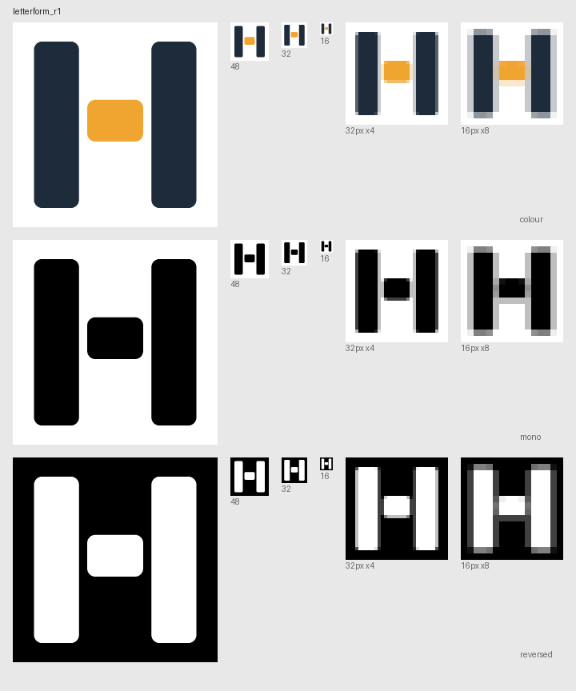
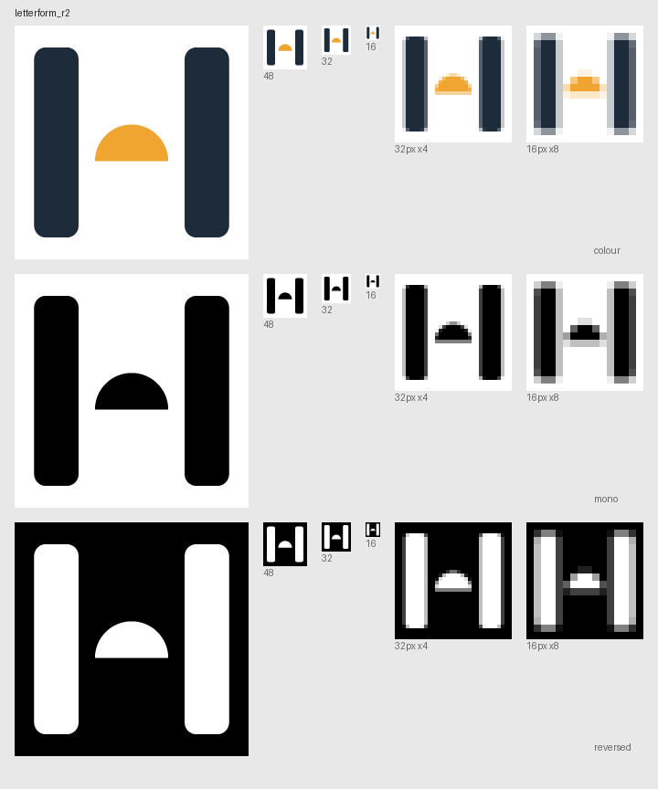
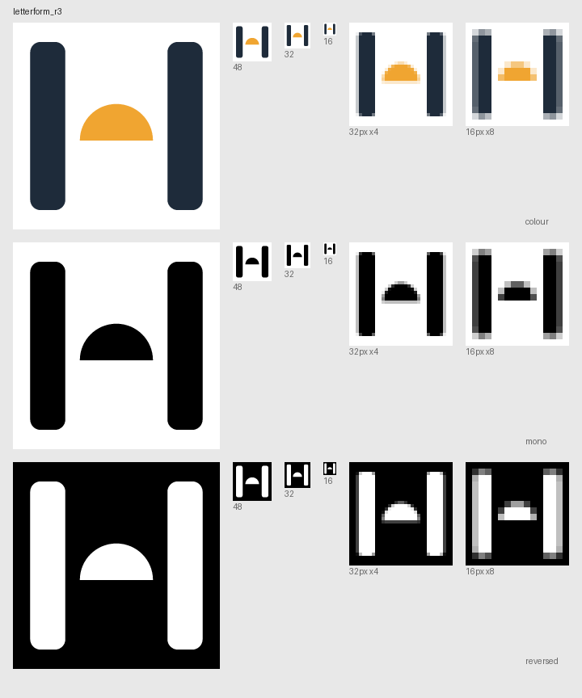
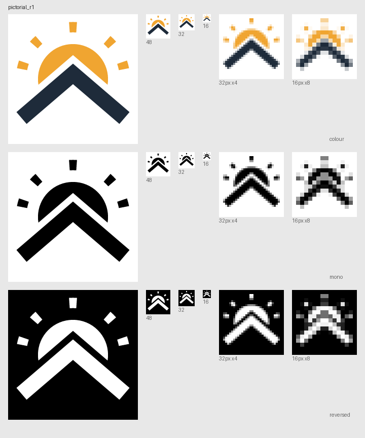
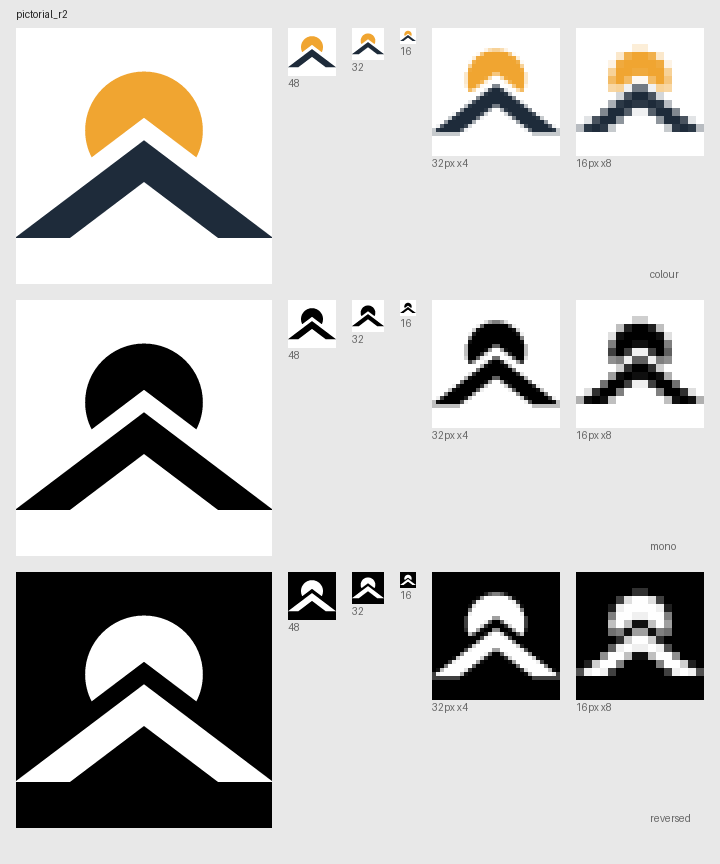
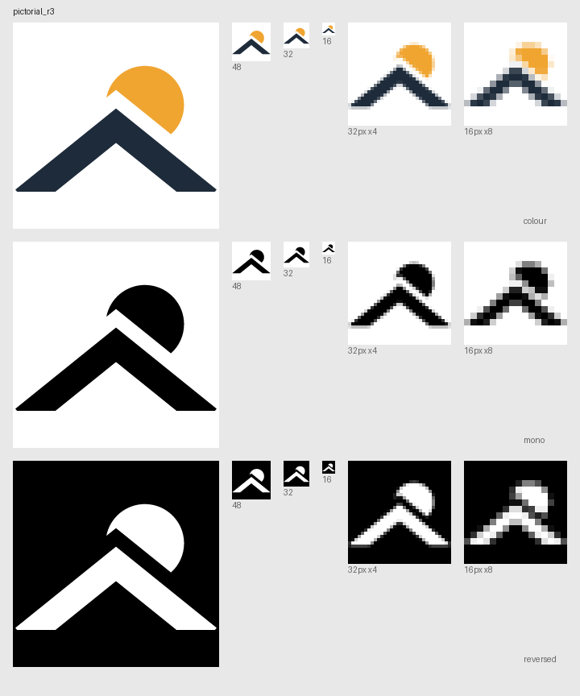
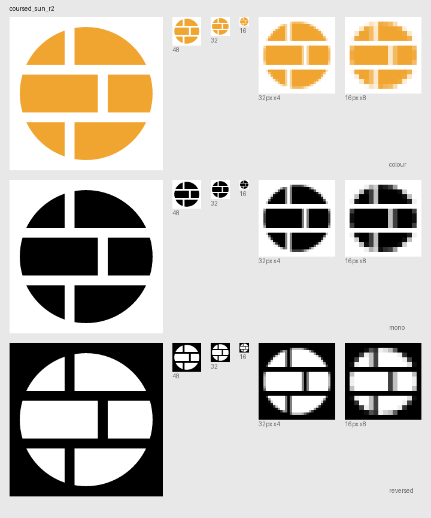
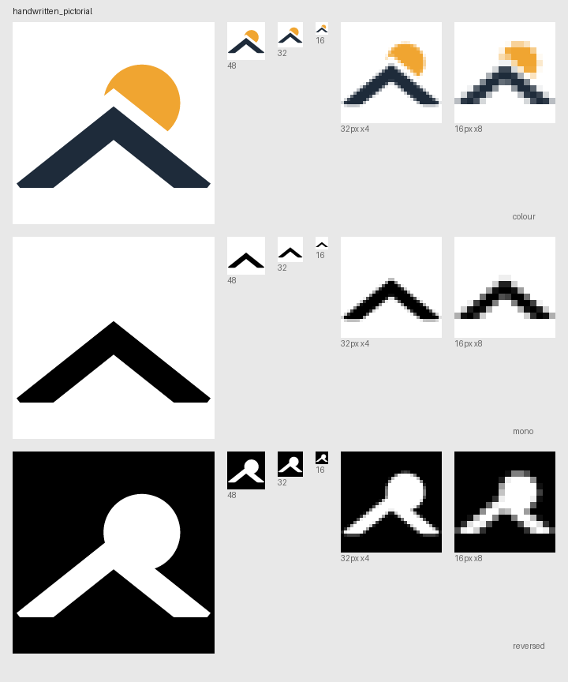
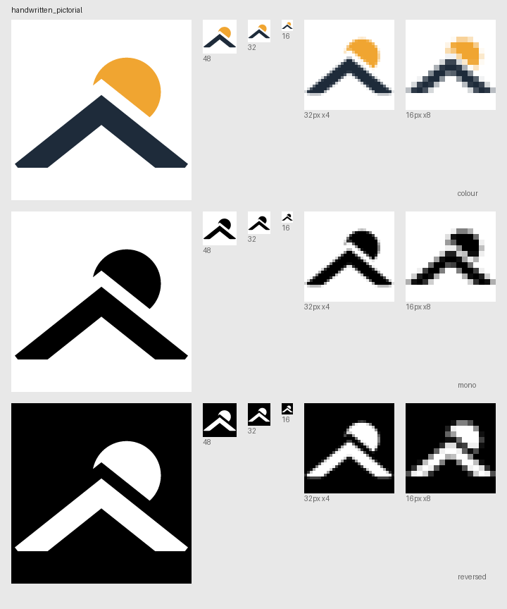
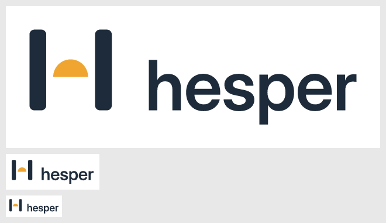

# Prototype: can a recipe over geometry primitives draw a convincing mark?

Throwaway groundwork for issue 15 ("Can a recipe over geometry primitives draw a convincing mark?"). **The ticket is not resolved here.** This folder exists so the HITL session can react to real marks, not argue in the abstract. You judge whether the marks convince you. The notes below are my own reading.

Labels used throughout: **Observed** means I ran it here on 2026-11-17 (Python 3.13.18, linux x86_64, the venv in `requirements.lock`). **Inference** means my reasoning, not run. **Opinion** means my taste as the agent that drew the marks.

Binding context: [mark-craft.md](../../research/mark-craft.md) (§1 rules, §10, §11), [svg-tooling.md](../../research/svg-tooling.md) (§1, §3–§5, §9), [brief-to-concept.md §5](../../research/brief-to-concept.md).

---

## How to run

```sh
# venv OUTSIDE the repo, wheels only
python3 -m venv /path/outside/repo/venv
/path/outside/repo/venv/bin/pip install --only-binary=:all: -r docs/prototypes/mark-primitives/requirements.lock
PY="/path/outside/repo/venv/bin/python -B"   # -B: no __pycache__ in the repo
D=docs/prototypes/mark-primitives

$PY $D/recipe_letterform.py  $D/out r3     # also r1, r2   -> out/<route>_<rev>.svg + .construction.json
$PY $D/recipe_pictorial.py   $D/out r3     # also r1, r2
$PY $D/recipe_coursed_sun.py $D/out r2     # also r1
$PY $D/gate.py $D/out/letterform_r3.svg    # -> .sheet.png + .gate.json, prints the check table
$PY $D/checks.py some.svg                  # script checks only
$PY $D/render_sheet.py some.svg out.png    # contact sheet only
$PY $D/outline_text.py FONT.otf hesper out.svg --size 100 --tracking -10
$PY $D/lockup.py /usr/share/fonts/opentype/inter/InterDisplay-SemiBold.otf $D/out
```

To gate the hand-written SVG, copy it somewhere first, because `gate.py` writes its outputs next to the input.

Font: Inter Display SemiBold (OFL-1.1, per `/usr/share/doc/fonts-inter*/copyright`) from the container's system fonts. No font file is in the repo, and no fetch was needed.

| File | What it is |
|---|---|
| `primitives.py` | ~270 lines. A `Mark` holds the construction log. Shapes: `circle`, `rect`, `rounded_rect`, `polygon`, `regular_polygon`, `annulus_segment` (ring sector, pie, or full ring), `stroke` (polyline → outline). Booleans: `union`, `difference`, `intersect`, `xor`. Transforms: `translate`, `rotate`, `scale`, `mirror`. Optical helpers: `overshoot`, `fit_overshoot`, `note_param`. Export: `svg`/`write` via fontTools `SVGPathPen`. All shapes are `pathops.Path`. |
| `outline_text.py` | HarfBuzz shaping (kern, liga) → fontTools glyphs → `pathops.Path`, then `simplify` (removes overlaps). |
| `render_sheet.py` | resvg-py renders at 256/48/32/16 px in colour, mono and reversed, plus 32 px ×4 and 16 px ×8 magnified, on one PNG. |
| `checks.py` | Script gate: min stroke and min gap at 16 px (absolute), extrema nodes (rule 7), SSIM 16 vs 256→16 (rule 15), mono distinctness (rule 17), and centroid vs bbox (rule 6, info only). |
| `gate.py` | Sheet + checks for each SVG. The model-visual half is me reading the PNG. |
| `brand.py`, `recipe_*.py` | Placeholder brief and three routes. Each recipe keeps every revision's parameters (`REVS`). |
| `handwritten_pictorial.svg` | The same concept as `recipe_pictorial r3`, hand-written without the library. |
| `lockup.py` | Mark + outlined wordmark lockup. |
| `out/` | SVGs, construction logs (`*.construction.json`), gate results (`*.gate.json`), contact sheets. |

---

## Placeholder brief

> **This is an invented, fictional company used only to exercise the tooling.** The user's real sample brands are decided in the separate ticket **"Which sample brands will prove the skill works?"**. Nothing here pre-empts that.

- **Name:** Hesper
- **Does:** makes modular solar roof tiles a homeowner can fit in a weekend.
- **Attributes:** sturdy, sunny, self-reliant.

Palette: slate `#1e2b3a` (roof, structure) and amber `#f0a531` (sun). The mark box is 100 × 100 units with a live-area padding of 100/12 (rule 12 default). **1 px at 16 px = 6.25 units.** This number decided most of what follows.

---

## The marks

The three routes differ by idea, not styling, and run safe → just right → unexpected (brief-to-concept §5). Each went through at most two redraw rounds after I viewed its contact sheet. "Script gate" means the checks in `checks.py`. The critique lines are model-visual and are my own reading (**opinion**).

### Route A (safe), letterform: an "H" built from roof tiles → a sun rising between the stems

**Rationale (final, r3).** The name's initial is built from the product. Two upright tiles form the stems of the H. The crossbar is a half-sun rising between them, so the letter reads as a house front at dawn: sturdy stems, a sunny centre. The mark is two parts in two colours, built from two rounded rectangles (one mirrored) and a 180° pie segment. The construction log is `out/letterform_r3.construction.json`.

| Round | Contact sheet | Script gate | What I saw → what I changed |
|---|---|---|---|
| r1 |  | **FAIL**: min gap 0.50 px @16 | Reads as H, but generic: a dumbbell or pause glyph that says nothing about tiles or sun. The 4-unit joints fill grey at 16 px, fusing bar and stems. Fixing only the joints would give a cleaner generic H. **Changed the structure:** crossbar → half-sun, joints 7 u. |
| r2 |  | PASS | Now ownable, but the sun is too small against heavy stems. It reads as "pillars + dot" at 16 px. **Changed:** stems 19 → 17 u, sun radius 15.7 → 17.7 u (+27 % area). |
| r3 |  | PASS | Best balance. Reads as H + sunrise at 32/48. At 16 px it reads as `|▲|`: it survives, just. **Opinion:** competent, plain, the most convincing of the three. |

Final gate (r3, observed): min stroke 2.50 px @16 PASS · min gap 2.50 px PASS · extrema 0 missing / 19 segs PASS · SSIM 0.976 PASS · mono: 2 colours, 2.25 px apart @32, parts/holes 3/0 at 512, 32 and 16 PASS · centroid offset 0.1 %.

### Route B (just right), pictorial: the sun behind a roof

**Rationale (final, r3).** A home that makes its own daylight. A thick slate gable cuts in front of an amber morning sun. The sun sits behind the right slope, so the scene has a time of day and is not a symmetric badge. A 7-unit gap separates sun and roof, so they stay two things in one colour. Construction: a stroked chevron (miter join) intersected with a rect to cut the eaves flat, and a circle minus the under-roof polygon minus a wider stroke used as the gap shield.

| Round | Contact sheet | Script gate | What I saw → what I changed |
|---|---|---|---|
| r1 |  | **FAIL**: min stroke 0.75, min gap 0.75 px @16 | Stock clip-art. The rays turn into grey speckle at 16 px. The chevron with diagonal ends reads as a rank insignia or "up" arrow. The visible sun is a thin crescent. **Changed:** dropped the rays (Apple HIG: few shapes), cut the eaves flat, raised the sun, gap 5 → 7 u. |
| r2 |  | PASS (but sun and roof **merge at 16 px**: parts 2 → 1) | **Mono reads as a "user" icon: head over shoulders.** No script check can see this. The leg extension also pushed the roof past the live area to the canvas edge. **Changed:** sun off-centre (cx 50 → 64), leg extension halved. |
| r3 |  | PASS | The person reading is gone, but **a gable with no walls reads as a mountain**, so this is now the outdoors/travel sun-over-peak cliché. The centroid is 7.0 % off the bbox centre (rule 6 would flag > 3 %). The roof still runs to x = 1.2 and 98.8, outside the 8.3-unit padding, and the flat eave cuts leave sharp wedge feet. **Round budget spent; left as known defects.** |

Final gate (r3, observed): min stroke 2.00 px PASS · min gap 1.00 px PASS (exactly at threshold) · extrema 0 / 13 PASS · SSIM 0.999 PASS · mono 2.25 px @32, parts 2/0 at all sizes PASS · centroid 7.0 % (dx +6.1, dy +3.5). **My checks have no padding check, so the bleed passed.**

### Route C (unexpected), abstract: a sun laid in courses of tiles

**Rationale (as intended).** The product *is* the sun. A disc is cut into horizontal courses with vertical joints in running bond, the way tiles are laid. From afar it reads as a sun, up close as a tiled roof. It is one colour on purpose, because the joints carry the idea.

| Round | Contact sheet | Script gate | What I saw → what I changed |
|---|---|---|---|
| r1 |  | **FAIL**: min gap 0.50 px @16 | **Reads as a brick ball** (masonry), not sun or roof tiles. Boolean cuts leave slivers at the disc edge. Its 15 parts collapse to 4 at 16 px. **Changed (parameters only, as a test):** 5 → 3 courses, joints 3.5 → 6.5 u, 1 vertical joint per course. |
| r2 |  | PASS | Pixel-clean at 16 px, but it reads as a hot-cross bun, a window or a drain grate. **The parameter change fixed the pixels, not the idea.** I parked this route instead of spending round 2 on it. |

Final gate (r2, observed): all PASS (min stroke 2.50, min gap 1.00, SSIM 0.999, 6/0 parts at all sizes). **This is the clearest case of a full script-gate pass on a mark that does not work.**

### Hand-written SVG of route B (no library)

`handwritten_pictorial.svg` is 17 lines, written from the same spec as `pictorial r3`: off-centre sun, 7-unit gap, flat eaves. It uses the native SVG I'd reach for by hand: a stroked `<polyline>`, a `<circle>`, a `<mask>` (to hide the sun behind the roof plus the gap) and a `<clipPath>` (for the flat eaves).

| Version | Contact sheet | Script gate |
|---|---|---|
| first run of the gate |  | **PASS. A false pass.** My regex recolouring also recoloured the mask's luminance fills, so in mono the sun vanishes and reversed turns it into a lollipop. The checks counted 4 "colours", including the mask's black and white. |
| after making recolouring skip `<defs>` |  | PASS, with the same numbers as recipe r3 (min stroke 2.00, min gap 1.00, sep 2.25 px @32, centroid 7.0 %) |

Observed: against recipe r3, the mean |Δalpha| is **1.07 / 1.15 / 1.28 of 255 at 256 / 32 / 16 px**, and no pixel differs by more than 50 % at 32 or 16 px. **Visually they are the same mark.**

### Lockup (exercises "text always outlined")



Letterform r3 + "hesper" in Inter Display SemiBold, outlined (`lockup.svg` contains no `<text>`; observed), tracking −10/1000 em. It uses mark-craft rule 21's *proposed defaults*: mark height 1.6 × ascender, gap 0.45 × mark width. **Opinion:** the gap is too wide and the mark too tall. The 17-unit stems are far heavier than the typeface's stems, so the mark and the word don't feel like one family. This is evidence that the rule-21 defaults need calibrating, not adopting.

---

## Hybrid recipe vs hand-written SVG, on craft

**Verdict (opinion, based on the observations above): for this mark the visual craft is a tie. The hybrid approach wins on everything around the pixels. Neither made a mark convincing; viewing the renders did.**

- **The final pixels are identical** (observed, Δ ≈ 1/255). Hand-writing was *faster* for me: one pass, 17 lines, eyeballed coordinates `(6,85)` against the recipe's computed `(5.27, 86.08)`.
- **The deliverable differs.** The recipe emits **two filled paths, 427 bytes**, with extrema nodes guaranteed and no masks or strokes (observed). The hand-written file depends on a mask, a clip path and a live stroke. To become a logo file that any consumer can use (cutters, embroidery, icon pipelines, Figma "outline stroke"), it still needs boolean flattening, which is the library's job (**inference**).
- **The hand-written file broke the gate tooling** (observed false pass above). Any hand-written path into the gate needs a normalisation step first (picosvg, svg-tooling §3.1) (**inference**).
- **Revision and honesty.** The recipe's `REVS` table makes r1 → r3 a readable diff of named parameters with a reason each. The construction log lets a rationale cite what was really built (mark-craft §2). The hand-written file has neither.
- **Where hybrid did *not* help.** Every improvement that mattered came from viewing the sheet: the generic H, rays as speckle, the person icon, the mountain, the brick ball, the hot-cross bun. No primitive prevented or detected any of them. **Inference:** hybrid will pull ahead on marks the hand cannot compute (tangent arcs, offsets of curves, booleans between curves), and this concept was too simple to show that.

## Where it fought me (specific, observed unless marked)

1. **skia-pathops API surprises.**
   - `Path.cubicTo` takes six flat floats, not three point tuples (a TypeError on first run; pens take tuples).
   - `Path.stroke(...)` mutates in place and returns `None`.
   - Round caps and joins come out as `CONIC` verbs. These must go through `convertConicsToQuads()`, which puts **quadratics into an otherwise cubic library**, about 2 quads per quarter-circle, so round caps are not node-economical (rule 8). I avoided round caps in the final marks for this reason.
   - `simplify()` moves contour start points.
2. **The 16 px constraint is invisible while composing.**
   - **All three r1 marks failed on the same thing:** joints or gaps below 6.25 units. My instinct for "crafted" (thin tile joints, fine rays) is exactly what dies at 16 px.
   - The fix was always to derive the minimum from the gate (box/16) *before* drawing. It belongs in the recipe as a constraint, not something to discover afterwards.
   - It also raises the rule-16 question: r1's thin joints looked better at 256.
3. **Booleans need primitives I didn't have.**
   - *Behind the roof with a gap* needed a hand-built "everything under the roof line" polygon, plus a stroke 2 × gap wider than the roof used as a shield. pathops has no offset, so a fattened stroke stood in for one.
   - *Flat eaves* needed hand-written vector maths to extend each leg down-slope, then an `intersect` with a rect.
   - The running-bond joints needed a hand-fiddled offset formula, and the cuts left slivers at the disc edge.
   - Missing: `offset(shape, d)`, `extend(segment, d)` / `cut_at_line`, and `min_part_size` sliver pruning.
4. **Optical corrections were mostly not primitive-level.**
   - `overshoot` was used once (the coursed-sun disc, 2 %) and the rule-3 bar thinning once (letterform r1).
   - The optical problems that mattered were compositional: off-centre mass (7 % in pictorial r3), mark-vs-type weight in the lockup, and unintended figures.
   - There is no `optical_centre` primitive, so I left pictorial r3 off-centre rather than spend a third round.
5. **My own gate had holes.**
   - The regex recolouring broke masks (false pass).
   - Topology was only enforced at 32 px, so the 16 px sun-roof merge in pictorial r2 passed.
   - There is no padding/live-area check, so pictorial r3's bleed passed.
   - **SSIM never failed anything** (0.976–0.999), not even coursed-sun r1 losing 11 of 15 parts at 16 px, and r3 of the letterform scored *lower* than r1 while looking better. This confirms svg-tooling §5.2: SSIM is a shape-identity signal, not a quality gate.
   - The width check had an off-by-one at exactly 1.0 px (strict `edt > r`) until I added a half-pixel tolerance. It was calibrated on a hairline ring, a 1 px line and a 0.8 px line before use.
6. **Conventions.** y-down SVG space plus counter-clockwise-on-screen angles had to be fixed once and documented. I derived the rotate matrix by hand. Every recipe author will trip on this unless the library owns it.

## Draft: a workable recipe format

This is **inference** from doing it three times: what I wished I had written down *before* drawing.

```python
ROUTE = dict(
    name="letterform", position="safe",                 # safe | just right | unexpected
    idea="H built from the product; crossbar is a rising sun",   # one sentence, tied to a brief attribute
    attributes=["sturdy", "sunny"],
    mark_type="letterform",                              # letterform | pictorial | abstract | wordmark
    risks=["generic H", "reads as pause/dumbbell"],      # unintended readings to look for in the render
)
CONSTRAINTS = dict(                                      # derived from the gate BEFORE drawing
    box=100, padding=100/12,
    min_stroke=100/16, min_gap=100/16,                   # = 1 px at 16 px
    max_parts=5, colours=2,
)
REVS = {                                                 # every revision kept; params named, in box units
    "r1": dict(stem_w=22, joint=4, ...),
    "r2": dict(..., why="viewed r1: generic H; joints fused at 16 px -> crossbar becomes half-sun"),
}
def build(rev) -> (Mark, layers):                       # only primitives; optical corrections via
    ...                                                  # m.note_param(name, value, why) so the log shows them
```

The gate output per revision: the script table, 2–4 model-visual lines (*reads as …*, *unintended figure?*, *survives 16 px?*, *centred?*), and the human questions it raises. Stop after 2 redraw rounds and record the remaining defects instead of hiding them.

## Open questions for you

1. **Do any of these marks convince you?** My ranking is letterform r3 > pictorial r3 > coursed sun (parked). I'd call all of them stock/student tier, not studio tier. Is that the bar the skill must clear, or is "competent and honest about its defects" acceptable for a first pass?
2. **Should the gate's minimums become construction constraints** (the library refuses or flags a joint below box/16 as you build), or stay as post-hoc checks? Every r1 failed on this.
3. **Rule 16: may a mark ship a separate small-size master?** Letterform r1's thin joints were nicer large, and a 16 px variant would let both live.
4. **Unintended readings** (person icon, mountain, brick ball, hot-cross bun) were caught only by viewing. Should the model-visual rubric name them explicitly ("list three things this could be mistaken for")?
5. **Recipe as Python with a `REVS` table** (as here), or a declarative spec (JSON/YAML) that one builder interprets? Python was flexible enough for the structural change in letterform r2. A spec would be easier to diff and to show you.
6. **Is hand-authored SVG allowed into the pipeline at all?** If yes, it needs a normalise step (picosvg / pathops flattening of masks, clips and strokes) before the gate, or the gate lies.
7. **Lockup ratios:** reject rule 21's defaults outright, or calibrate them on known-good lockups first?
8. **Which missing primitives are worth building:** `offset`, `extend`/`cut_at_line`, `optical_centre`, tangent arc constructions, sliver pruning?
